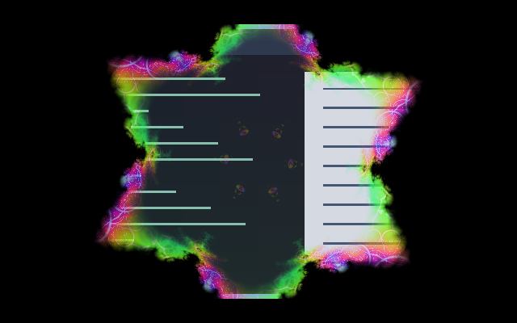

# Fractal Bloom

Windows appear and disappear through a mirrored kaleidoscope mandala. Twelve repeated wedges form a star-shaped opening with rotating neon fractal ornament. A centre-out bias keeps the transition legible.

[Opening animation](preview.gif) · [Closing animation](preview-close.gif).
Native compositor frames sampled every 50 ms at the recommended 700/450 ms durations.

## Use

Install the collection at `~/.config/umbriel/shaders/community/` and merge
[config.toml](config.toml) into your existing configuration tables, appending
its include paths. Do not include the activation example as a preset or repeat
existing TOML tables. The [Psychedelic family](../../families.toml) groups the coordinated effects
and their recommended selections.

## Tuning

INTENSITY = 0.85 controls glow opacity; PATTERN_SCALE = 180.0 sets logical pixels per fractal unit; EDGE_WIDTH = 0.10 sets the glowing threshold band (0.03–0.2).

Controls are constants in [shader.glsl](shader.glsl), except border speed,
padding and event durations, which belong in TOML. Colours are procedural and
do not use the theme palette. No external textures are required.

## Compatibility and cost

One source sample and two six-iteration fractal evaluations per pixel during transitions. A stable per-event seed rotates the mandala without breaking its symmetry. Visibility uses a fixed field while the ornament turns. Opening and closing use the same shader; exact visible endpoints return the source and invisible endpoints return transparent black.

The preview is a real headless compositor capture over synthetic content.
Still images do not demonstrate motion quality.

Tested in private Umbriel 0.1.0 (`28fa214`) sessions over synthetic content.
Native HDR, rotated or fractional-scale outputs, interrupted transitions and
hardware performance remain unverified.

Original procedural shader by Barrulus. [MIT licensed](../../LICENSES/Barrulus-MIT.txt).
