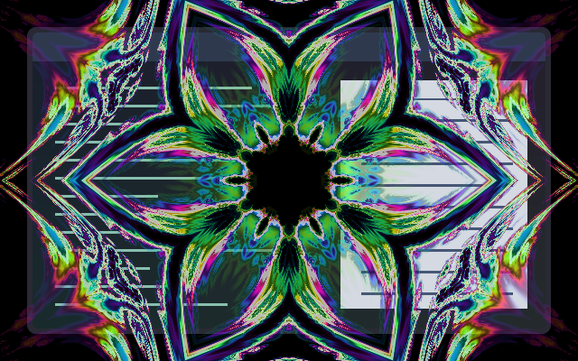

# Fractal Iris

A rolling fractal front reveals the incoming workspace. Successive mirrored folds unfold along the lip, small tears open ahead of it, and those tears widen and merge into the main opening. The contours change topology as they grow: neither a circular mask nor a fixed shape is scaled. Both scenes stay stationary.

[Animated preview](preview.gif) · [Reverse playback](preview-reverse.gif).
Native compositor frames sampled every 50 ms over the 1100 ms transition; the
incoming workspace is empty in this capture. The reverse GIF plays those same
frames backwards to show how the folds close when progress reverses.

## Use

Install the collection at `~/.config/umbriel/shaders/community/` and merge
[config.toml](config.toml) into your existing configuration tables, appending
its include paths. Do not include the activation example as a preset or repeat
existing TOML tables. See the [Psychedelic family](../../families/psychedelic/) for
all four effects together.

## Tuning

| Constant | Default | Meaning |
| --- | --- | --- |
| `INTENSITY` | `0.94` | Opacity of the coloured rolling lip. |
| `BAND_WIDTH` | `0.14` | Width in reveal-progress units; 0.03–0.24. Larger values show more nested contours. |
| `DETAIL_SCALE` | `0.24` | Fractal feature scale as a fraction of the shorter dimension; 0.10–0.50. |
| `ADVANCE_TEARS` | `0.12` | How far detached tears lead the front, in progress units; 0–0.20. |

Controls are constants in [shader.glsl](shader.glsl), except border speed,
padding and event durations, which belong in TOML. Colours are procedural and
do not use the theme palette. No external textures are required.

## Compatibility and cost

The front traverses a fixed fractal arrival-time field. Advancing the threshold
opens new contours and merges holes; nested colour bands roll across those
contours. Every pixel reveals monotonically, and reversing progress retraces
the same folds and tears. No time-dependent random changes or zoom are used.

Up to two scene samples and six six-iteration fractal evaluations per pixel
within the rolling lip; outside it, one scene sample and two fractal evaluations.
The extra evaluations estimate the local slope for antialiasing. No feedback
buffers. Requires the full-scene workspace reveal API (`umbriel_sample_incoming`).

The 2026-10-25 revision passed 624 software-GLES frames covering endpoints,
monotonic visibility, central symmetry, aspect ratios, scale values and source
alpha. An additional mask check confirmed detached openings appearing and
merging across the transition. The native preview contains 26 compositor frames.

The preview is a real headless compositor capture over synthetic content.
See [family validation](../../families/psychedelic/README.md#validation) for tested
versions and limitations. Still images do not demonstrate motion quality.

Original procedural shader by Barrulus. [MIT licensed](../../LICENSES/Barrulus-MIT.txt).
