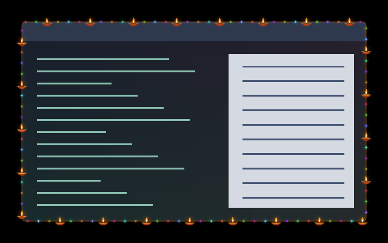

# Diya Lights

Small terracotta oil lamps straddle the focused window's edge, approximately
half inside and half outside. They remain upright around rounded corners and
are 40% smaller than the original version (about 14 logical pixels across).
Three multicoloured lights fill each gap, twinkling independently with short
star-shaped glints. Warm flames sway gently above gold-edged bowls.

[Animated preview](preview.gif). Native headless capture over synthetic content.
Screen-edge examples: [top and left](preview-top_left.png),
[bottom and right](preview-bottom_right.png). The outward halves clip at the
screen edge; the matching inward artwork stays visible on the window.

## Use and tuning

Merge [config.toml](config.toml), following the [collection instructions](../../packs/diwali/README.md#install-and-enable).
Select `diwali.diya-lights` as the border.
The border automatically includes [Diya Glow](../../window/diya-glow-overlay/README.md).
Keep both directories in their relative locations and do not select the overlay separately.

Edit [the shared artwork](../../packs/diwali/tools/diya-material.glsl), then run
`python3 packs/diwali/tools/generate_diya.py` from the
repository root. Both standalone shaders are generated together so lamp centres,
colours and flicker stay aligned across the client edge.

- `LAMP_SPACING = 72.0`: approximate logical pixels between lamps; try 56–96.
- `LAMP_SCALE = 0.60`: size relative to the original 23-pixel-wide lamp.
- `INTENSITY = 0.98`: artwork opacity, from 0 to 1.
- `REACH = 14.0`: hard bound on each side; only the soft halo reaches this far.

Keep `padding = 16` for this geometry. The preset's `speed` and `animated`
settings control both halves, including the coloured twinkles. The overlay
preserves source alpha and leaves content beyond 14 pixels inside untouched.
Both effects follow border eligibility and disappear in fullscreen.

## Compatibility and cost

Tested in Umbriel 0.1.0 (`8449975`); see [validation](../../packs/diwali/README.md#compatibility-and-validation).
Each material evaluation checks three nearby lamps and three nearby light
positions. The border reserves 16 logical pixels of padding. Its companion
adds a window pass for the eligible focused window, returning immediately
outside the shallow inner fringe. No native border-light or feedback passes
are used. Hardware performance and native HDR/rotation/fractional scaling
remain unverified.

Original artwork by Barrulus with Codex assistance; perimeter geometry adapted
from Barrulus's Fairy Lights and Ghostly Tear Border.
[MIT license](../../LICENSES/Barrulus-MIT.txt).
