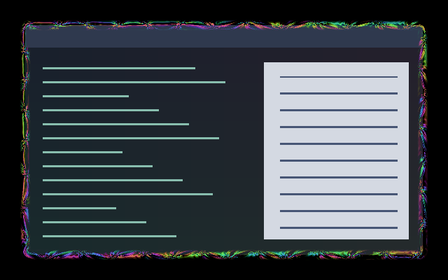

# Fractal Flow

A rolling fractal front surrounds the focused window. Folds open, split and merge as a moving contour traverses the same nested fractal fields used by Fractal Iris. The companion carries the motion inward. The bright core stays narrow, with a fading reach of eight logical pixels per side.

[Eight-second motion preview](preview.gif) · [Enlarged edge detail](preview-detail.gif).
Native compositor frames at 100 ms intervals; the detail crop is enlarged 2×.

## Use

Install the collection at `~/.config/umbriel/shaders/community/` and merge
[config.toml](config.toml) into your existing configuration tables, appending
its include paths. Do not include the activation example as a preset or repeat
existing TOML tables. Choose **Psychedelic → Apply family** in the plugin to apply the coordinated effects.

## Tuning

| Constant | Default | Meaning |
| --- | --- | --- |
| `INTENSITY` | `0.90` | Opacity of the rolling lip. |
| `PATTERN_SCALE` | `90.0` | Approximate logical pixels per large fold; not a row of identical tiles. |
| `REACH` | `8.0` | Maximum logical pixels on each side, fading from a narrow core. |
| `ROLL_SPEED` | `0.24` | Contour cycles per second. |

Keep the constants and shared helpers aligned with the companion. Padding is
nine pixels; increase it in effect.toml if increasing REACH. Border speed
scales both clocks; animated = false freezes both. The same fields wrap the
rounded perimeter, with matched phase and colour at the seam.

Controls are constants in [shader.glsl](shader.glsl), except border speed,
padding and event durations, which belong in TOML. Colours are procedural and
do not use the theme palette. No external textures are required.

## Compatibility and cost

Six evaluations of a six-iteration fractal helper per shaded edge pixel,
including local slope estimates for antialiasing. Both shaders return early
outside their eight-pixel bands; the companion samples the source once and
preserves its alpha. No feedback or native border light. Focus, decoration
and fullscreen gating follow Umbriel's border rules. Requires window
corner-radius uniforms for the companion.

The rolling revision compiled and rendered on Umbriel 0.1.0 (`28fa214`) across
81 native frames. Each shader passed 624 software GLES frames covering aspect
ratios, scale values, time, source opacity and premultiplication. Another 54
frames checked perimeter continuity and the eight-pixel bound. Maximum sampled
seam difference was 4/255 per channel across points 0.0002 logical pixels apart.
The border and companion use identical material helpers.

The preview is a real headless compositor capture over synthetic content.
See [family validation](../../VALIDATION.md#psychedelic-effects-2026-10-25) for tested
versions and limitations. Still images do not demonstrate motion quality.

Original procedural shader by Barrulus. [MIT licensed](../../LICENSES/Barrulus-MIT.txt).
