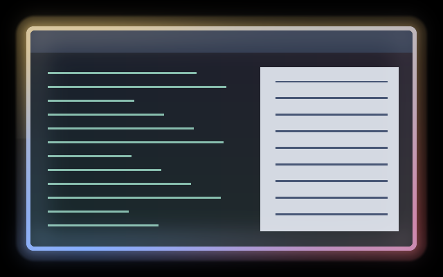

# Spectrum

An audio-driven colour halo around the focused window. The angle around the
border maps the low-to-high spectrum, while overall activity lifts the ring.
It returns to the native border during silence; it has no clock-driven pulse.
The configured compositor light can still glow from that native border.



Native Umbriel capture over synthetic window content with a synthetic spectrum
and the default theme palette. Includes compositor light; this is not a capture
of music playing on a desktop.

## Use

Save [effect.toml](effect.toml) and [shader.glsl](shader.glsl) together in
`~/.config/umbriel/shaders/community/border/spectrum/`. Keep the
[MIT license](../../LICENSES/Barrulus-MIT.txt) with the files. Then merge:

```toml
[include]
files = ["shaders/community/border/spectrum/effect.toml"]

[effects]
border = "spectrum"
```

Append to an existing include list and merge into existing tables, rather than
duplicating them. [config.toml](config.toml) has the same example. Borders apply
to focused, decorated, non-fullscreen, non-urgent windows. There is no companion
overlay. [Music Radiance](../../cursor/music-radiance/) can use the same feed.

## Audio setup

Enable Noctalia's **Settings → Umbriel → Audio → Provide Audio to Umbriel**,
or use the [standalone Python analyser](../../tools/README.md#standalone-audio-analyser)
with older Noctalia or another shell. Run only one provider. Merely including
this preset does not start capture.

Requires the 64-band `umbriel_audio_spectrum(position)` API, tested with
Umbriel `76477c2`. The older scalar and bumbriel 16-band APIs cannot run this
version. Old `[effects.audio.sources]` and per-preset `audio` settings are no
longer needed. All effects share the externally supplied spectrum.

The port estimates activity from the mean of all 64 bands or one quarter of
their peak, whichever is greater. It applies a square-root response to retain
quiet detail. This replaces the original RMS/envelope inputs; it is a visual
estimate, not calibrated loudness. Band positions do not promise fixed Hz.

## Tuning

| Control | Default | Effect |
| --- | --- | --- |
| GLSL `AUDIO_GAIN` | `1.0` | Response strength; try `0.5`–`2.0`. High values saturate. |
| GLSL `NOISE_FLOOR` | `0.005` | Per-band dead zone; use `0` for maximum sensitivity, keep below `1`. |
| TOML `palette` | `true` | Use theme accents, warning and error colours. False uses blue-cyan. |
| TOML `padding` | `24` | Space for the shader halo, which fades between 18 and 24 logical pixels. |
| TOML `animated` | `false` | Audio changes trigger redraws without a shader clock. |
| TOML light `spread` / `intensity` / `threshold` | `48` / `1.0` / `0.35` | Compositor glow. Remove the whole light table to disable it. |

Changing `speed` does nothing: this shader never reads time. Save shader edits
to reload them; see [reloading edits](../../README.md#reloading-edits).

## Compatibility and cost

One border pass plus compositor light and blur; no feedback buffers. When a
feed is available, each fragment samples all 64 band positions and its local
angular band. Without a feed it returns the native sample immediately.
An unchanged spectrum does not request animation frames. See
[validation](../../VALIDATION.md) for tested behaviour and limits; hardware
performance has not been benchmarked.

## Attribution

Author/contributor: Barrulus. [MIT](../../LICENSES/Barrulus-MIT.txt).
Ported from [bumbriel's Spectrum](https://github.com/barrulus/bumbriel/tree/1dafcac5f008e7a9db32940839f1aff962909544/examples/effects/border/spectrum).
Retuned for normalized 64-band intensities rather than the original linear
16-band amplitudes and separate RMS/envelope feed.
