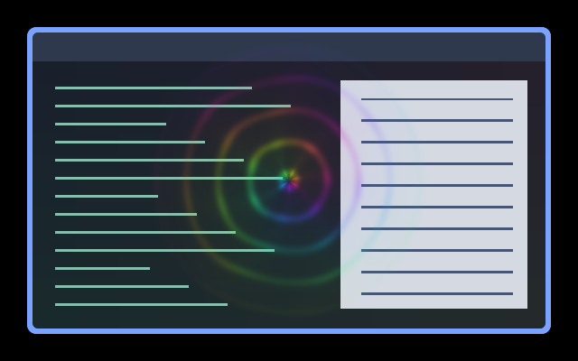

# Music Radiance

Expanding rainbow waves and rotating rays around the pointer, with brightness
and reach driven by audio. The effect disappears during silence and preserves
the native pointer image.



Native Umbriel capture over synthetic window content with a synthetic spectrum.
The rainbow is the shader's own colour cycle; the pointer image is omitted.

## Use

Save [effect.toml](effect.toml) and [shader.glsl](shader.glsl) together in
`~/.config/umbriel/shaders/community/cursor/music-radiance/`. Keep the
[MIT license](../../LICENSES/Barrulus-MIT.txt) with the files. Then merge:

```toml
[include]
files = ["shaders/community/cursor/music-radiance/effect.toml"]

[effects]
cursor = "cursor.music-radiance"
```

Append to an existing include list and merge into existing tables, rather than
duplicating them. [config.toml](config.toml) has the same example. The effect
covers a square of half-size 160 logical pixels around the pointer and is
clipped at output edges. It follows pointer position, not pointer history.

## Audio setup

Enable Noctalia's **Settings → Umbriel → Audio → Provide Audio to Umbriel**,
or use the [standalone Python analyser](../../tools/README.md#standalone-audio-analyser)
with older Noctalia or another shell. Run only one provider. Merely including
this preset does not start capture. [Spectrum](../../border/spectrum/) can
share the same feed.

Requires the 64-band `umbriel_audio_spectrum(position)` API, tested with
Umbriel `76477c2`. The older scalar and bumbriel 16-band APIs cannot run this
version. Remove old `[effects.audio.sources]` and per-preset `audio` settings.

Activity is the square root of the mean of all 64 bands or one quarter of
their peak, whichever is greater, after gain and noise-floor adjustment.
This replaces the original RMS/envelope inputs with a visual estimate.
An angular low-to-high-to-low spectrum mapping modulates the waves without
a seam. Silence and missing feeds return the sampled scene unchanged.

## Tuning

| Control | Default | Effect |
| --- | --- | --- |
| GLSL `AUDIO_GAIN` | `1.0` | Response strength; try `0.5`–`2.0`. High values saturate. |
| GLSL `NOISE_FLOOR` | `0.005` | Per-band dead zone; use `0` for maximum sensitivity, keep below `1`. |
| GLSL wave time multiplier | `0.85` | Expansion speed of the rings. |
| GLSL ray count | `7.0` | Number of rotating rays; keep a positive integer. |
| GLSL edge fade | `135.0`–`158.0` | Logical-pixel radius where the artwork fades out. |
| TOML `radius` | `160` | Half-size of the affected square. Keep at least the artwork's outer fade radius. |

This preset retains its original rainbow colours and does not read the theme
palette. Cursor presets have no TOML `speed` or `animated` controls. Global
`[effects] max_fps` caps effect-driven frames. For screenshots, enable
`[effects] in_capture = true` if needed. See
[reloading edits](../../README.md#reloading-edits).

## Compatibility and cost

One cursor-area pass with no feedback buffers. Available feeds cause 64 band
samples per fragment plus one angular sample for audible activity. Without
a feed it returns the scene immediately. The linked shader reads time, so
it can request frames even while its artwork is invisible during silence;
it also prevents direct scanout while active. See [validation](../../VALIDATION.md)
for tested behaviour and limits; hardware performance has not been benchmarked.

## Attribution

Author/contributor: Barrulus. [MIT](../../LICENSES/Barrulus-MIT.txt).
Ported from [bumbriel's Music Radiance](https://github.com/barrulus/bumbriel/tree/1dafcac5f008e7a9db32940839f1aff962909544/examples/effects/cursor/music-radiance).
Retuned for normalized 64-band intensities rather than the original linear
16-band amplitudes and separate RMS/envelope feed.
