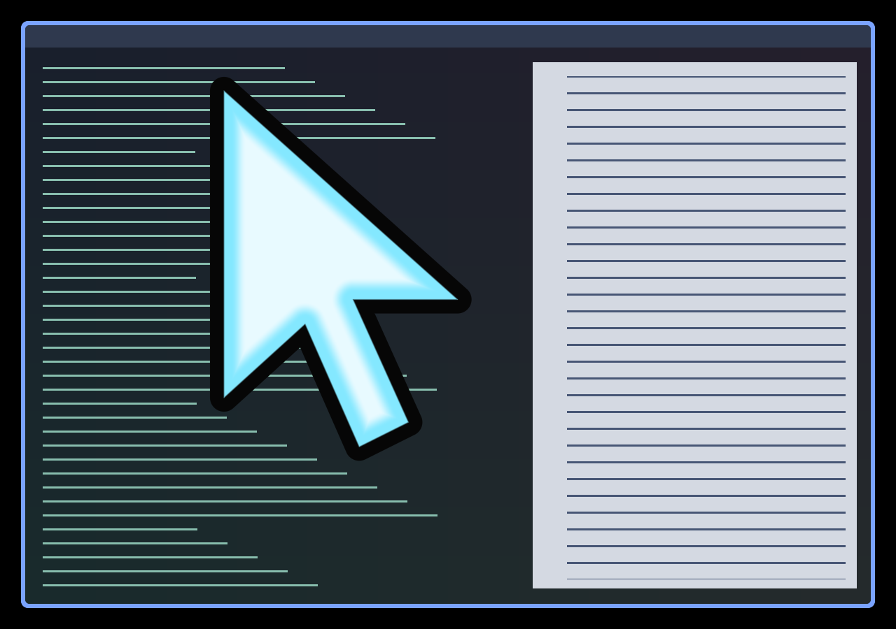

# Shake Grow

Repeated quick back-and-forth movement reveals an icy-white
arrow with a cyan rim and dark outline. Each qualifying reversal adds size;
sustained shaking builds toward an 18-times base-size limit. After shaking
stops, the arrow holds briefly, then shrinks and fades away within about 0.8
seconds. Ordinary pointer travel stays invisible.



The preview is a real headless Umbriel capture over synthetic sample content,
with injected shaking. It is not a capture of the user's desktop.

This is an arrow drawn **underneath the actual cursor**, with its tip at the
same hotspot. It does not resize or replace the real cursor, inherit the
cursor theme, or change shape over links and text. Cursor effects cannot
sample or resize the cursor image in the current shader API.

## Use

Keep [effect.toml](effect.toml) and [shader.glsl](shader.glsl) together under
`~/.config/umbriel/shaders/community/cursor/shake-grow/`. Retain the license notice
linked below. Merge [config.toml](config.toml) into your configuration,
appending to the include list and merging existing tables:

```toml
[include]
files = ["shaders/community/cursor/shake-grow/effect.toml"]

[effects]
cursor = "cursor.shake-grow"
```

Including the preset registers it; selecting it activates it. Choose one cursor
effect at a time. No companion presets are required. To include the artwork in
screenshots, set `[effects] in_capture = true`.

## Tuning

Constants at the top of `shader.glsl` control the behavior; edits reload.

| Constant | Default | Meaning |
| --- | --- | --- |
| `kMinStep` | 3 | Ignore smaller sampled motion, in logical pixels. |
| `kMinSpeed` | 180 | Minimum sampled speed, logical pixels/second. |
| `kMinLeg` | 24 | Minimum travel before a reversal. Lower for smaller shakes. |
| `kMaxTurnGap` | 0.32 | Maximum seconds between qualifying reversals. |
| `kTurnDot` | -0.4 | Required direction reversal; more negative means sharper. |
| `kHold` | 0.35 | Seconds to hold visibility after the latest shake. |
| `kFade` | 0.80 | Seconds until fully invisible; must exceed `kHold`. |
| `kStartScale` | 1.45 | Initial overlay scale relative to its 29-pixel arrow. |
| `kGrowthPerTurn` | 1.50 | Added scale for each qualifying recent reversal. |
| `kMaxScale` | 18 | Maximum scale, roughly 560 logical pixels including outline. |
| `kFill`, `kAccent` | ice/cyan | RGB fill and rim colors. |

Growth steps ease over 90 ms. Motion history retains only two seconds, so
growth is reconstructed from recent shakes rather than remembered indefinitely.
Shakes older than 1.45 seconds gradually stop contributing by 1.8 seconds.
Continuous fast shaking reaches the size cap; weaker or intermittent shaking
can settle below it or vary in size. Raise preset `radius` to at least
`ceil(35 * kMaxScale)` if increasing the size cap.

## Compatibility and cost

Requires `umbriel_pointer_path[64]`. No daemon, compositor changes, feedback
buffers, or continuously advancing clock are used. One bounded history scan
and seven polygon edges run near the arrow; early bounds skip this work
elsewhere in the history-expanded drawing rectangle. The compositor stops
requesting effect frames after motion history expires, up to two seconds after
movement stops. Hardware performance has not been benchmarked.

Output crossings, hiding, locking, and shader changes reset motion history.
The arrow clips at output edges, so it can be partly offscreen near the right
or bottom edge. It always retains the normal cursor's hotspot location.

## Validation

Tested with Umbriel 0.1.0 (`3667399`) using Mesa software rendering in private
headless sessions. Configuration validation, selected-program GLSL compilation,
and motion captures were checked separately. The preview was visually inspected.

Sensitivity may need tuning for your mouse. Fractional scaling, rotated outputs,
HDR, transparent input, and hardware GPU performance remain unverified.

## Attribution

Original shader by Barrulus, 2026. Shake Grow uses the detector from
[Shake Locator](../shake-locator/). Licensed under the
[Barrulus MIT license](../../LICENSES/Barrulus-MIT.txt).
