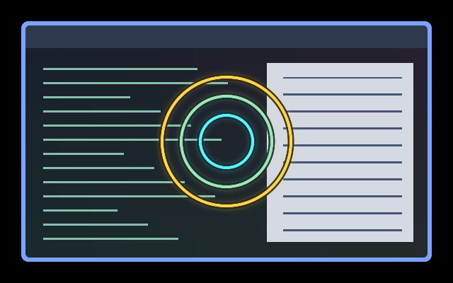

# Shake Locator

Shake the pointer back and forth to reveal three cyan,
mint, and gold locator rings. Ordinary travel leaves the desktop untouched.
The rings follow the pointer and fade out within about 0.6 seconds of the last
qualifying reversal, including while ordinary movement continues.



This is a real headless Umbriel capture over synthetic sample content, with
injected horizontal shaking. It is not a capture of the user's desktop.

## Use

Keep [effect.toml](effect.toml) and [shader.glsl](shader.glsl) together under
`~/.config/umbriel/shaders/community/cursor/shake-locator/`. Retain the license notice
linked below. Merge [config.toml](config.toml) into your configuration,
appending to the include list and merging existing tables:

```toml
[include]
files = ["shaders/community/cursor/shake-locator/effect.toml"]

[effects]
cursor = "cursor.shake-locator"
```

Including the preset registers it; selecting it activates it. Choose one cursor
effect at a time. No companion presets are required. To include the artwork in
screenshots, set `[effects] in_capture = true`.

## Tuning

Edit the constants at the top of `shader.glsl`; Umbriel watches the file.

| Constant | Default | Meaning |
| --- | --- | --- |
| `kMinStep` | 3 | Ignore smaller sampled steps, in logical pixels. |
| `kMinSpeed` | 180 | Minimum sampled speed, logical pixels/second. |
| `kMinLeg` | 24 | Minimum travel before a qualifying reversal. Lower for easier activation. |
| `kMaxTurnGap` | 0.32 | Maximum seconds between two substantial reversals. Raise for slower shakes. |
| `kTurnDot` | -0.4 | Direction-change threshold; more negative requires a sharper reversal. |
| `kFade` | 0.60 | Fade duration in seconds after a qualifying reversal. Keep below 1.4. |
| `kRingSize` | 1 | Ring size multiplier. Increase preset `radius` to at least `ceil(132 * kRingSize)` if enlarged. |
| `kInnerColour`, `kOuterColour` | cyan/gold | RGB ring colours, each component 0–1. |

## Compatibility and cost

Requires the 64-sample `umbriel_pointer_path` API. Detection uses substantial,
fast direction reversals close together, with a short fade-in and age-based
fade-out. No daemon, compositor change, feedback texture, or clock uniform is
needed. The compositor stops requesting effect frames once motion history
expires (up to two seconds after movement stops).

There is one bounded 64-sample scan per fragment near the rings. The history
expands the drawing rectangle to cover recent travel; an early distance check
skips the scan elsewhere. It is still a cursor effect with capture/composition
cost while selected. Hardware performance has not been benchmarked.

History resets at output crossings, hiding, lock, and shader changes. Shaking
across an output boundary can therefore interrupt activation or fading. This
is a heuristic: real mouse sensitivity may need tuning.

## Validation

Tested with Umbriel 0.1.0 (`3667399`) using Mesa software rendering in private
headless sessions. Configuration validation, selected-program GLSL compilation,
and motion captures were checked separately. The preview was visually inspected.
See the [validation record](../../VALIDATION.md#shake-reactive-cursors-2026-10-27)
for measured behavior and remaining limitations.

Sensitivity may need tuning for your mouse. Fractional scaling, rotated outputs,
HDR, transparent input, and hardware GPU performance remain unverified.

## Attribution

Original shader by Barrulus, 2026. Licensed under the
[Barrulus MIT license](../../LICENSES/Barrulus-MIT.txt).
