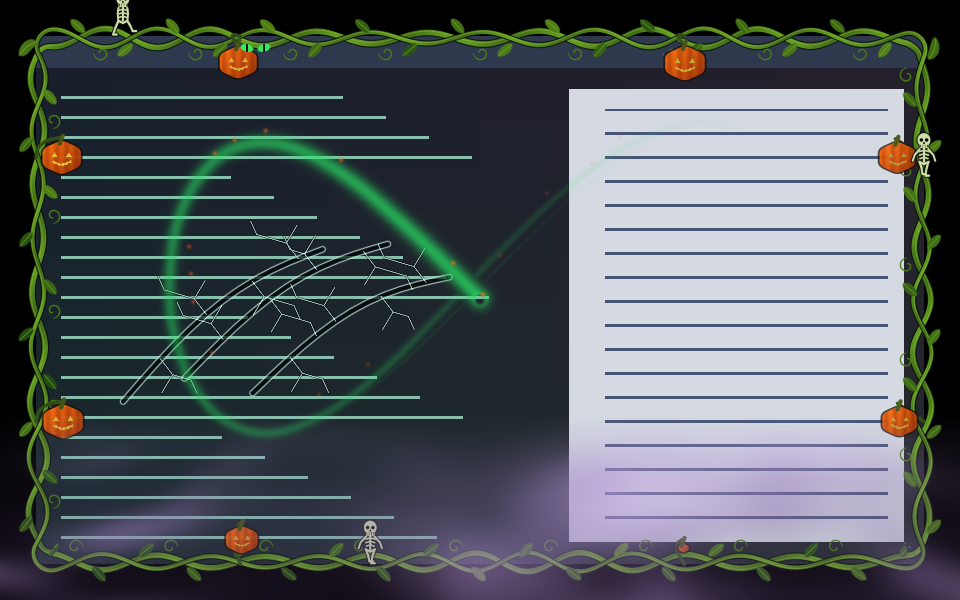
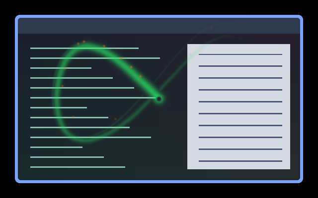
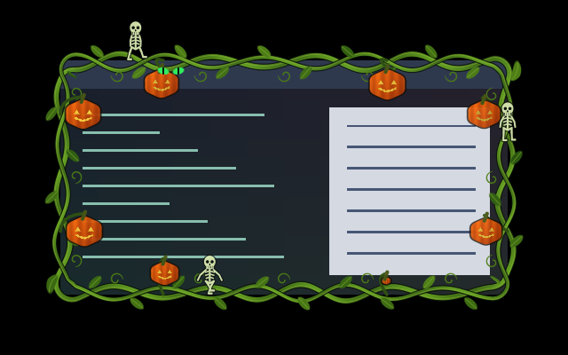
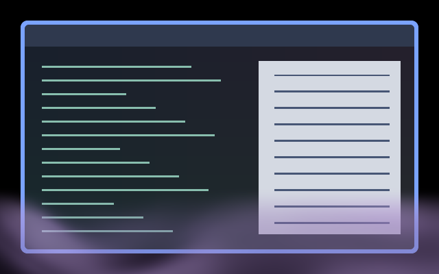
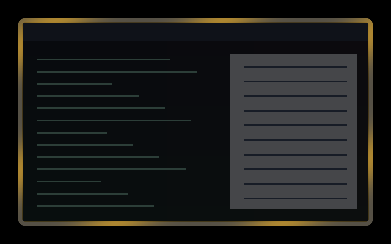

# Umbriel After Dark — Halloween Family

Six coordinated shaders inspired by Umbriel’s Halloween icon: pumpkin orange,
witch green and charcoal purple. The defaults make the seasonal artwork clearly visible, with most decoration
near edges and a shorter close animation.

The combined preview shows the four persistent effects over synthetic content.

| Surface | Effect | Preview |
| --- | --- | --- |
| Cursor | [Witchfire](../../cursor/witchfire/) — long curved fire ribbon, wisps and embers |  |
| Border | [Something’s Watching](../../border/somethings-watching/) — pumpkin vines, cat eyes and a skeleton parade, with an inward overlay |  |
| Window | [Haunted Glass](../../window/haunted-glass/) — a claw strike, glass distortion and healing fractures |  |
| Screen | [Midnight Fog](../../screen/midnight-fog/) — low purple mist |  |
| Open | [Crescent Reveal](../../animation/crescent-reveal/) — diagonal pumpkin-fire reveal |  |
| Close | [Candle Snuff](../../animation/candle-snuff/) — quick fade and confined edge flicker |  |

## Enable the family

Install the collection at `~/.config/umbriel/shaders/community/`, or download
`effect.toml` and `shader.glsl` from each of the six linked directories,
preserving their relative paths. The border also needs both files from
[its companion overlay](../../window/somethings-watching-overlay/); it includes
that preset automatically. Retain the [license](../../LICENSES/Barrulus-MIT.txt).

Merge [config.toml](config.toml) into `~/.config/umbriel/config.toml`.
Append its six include paths to the existing list and merge its settings into
existing tables; do not paste duplicate tables or include this activation
example as a preset. Each effect can also be selected independently.

The configuration selects all four persistent effects, a **1300 ms opening**,
and a **240 ms closing**. Closing content fades early, with only a brief flicker
following its visible silhouette, so the next focused window can take over.
There is no last-window special case or lingering animation outside the window.
Your decoration width and corner radius remain your own; the garden uses 48 logical
pixels of extra border padding. The previews use a six-pixel native border.

Each shader exposes an `INTENSITY` constant near the top of `shader.glsl`.
These are individual GLSL controls, not TOML parameters. Lower the values for
quieter decoration; the individual READMEs explain additional controls.
Animation intensity changes decoration, while visibility still follows the event.
Colours intentionally stay seasonal rather than following the theme palette.

To disable the persistent family, clear its four `[effects]` selectors. Clear the
two event `effect` selectors to return to native transitions, or set the events’
`enabled = false` to turn their animations off entirely. Restore your previous
selectors if you were using other effects.

## Preview and compatibility

The PNGs are real headless Umbriel captures over synthetic light and dark
content, each showing one effect. The animation captures use the family’s 1300/240 ms linear timelines at progress
0.50 (opening) and 0.45 (closing). Each animation directory also has a
`preview.gif` sampled from compositor frames at 25 fps using those durations.
Still frames do not demonstrate motion quality.
The [interactive animation preview](../../preview/) includes both transitions
for playback, scrubbing and inspection of different window shapes.

Requires Umbriel’s preset-effects API plus the newer pointer-history API for
Witchfire. The cursor does not replace the pointer sprite. Eyes appear only on
the focused, decorated window; glass applies to all selected windows and fog
to the output. Haunted Glass now attacks the window with three hooked talons, replacing
the earlier ghost hand. Its [full-cycle preview](../../window/haunted-glass/preview.gif)
shows the strike and healing fractures at normal speed.

None of the effects uses previous-frame feedback. Window and
screen effects animate continuously; performance depends on window count,
output resolution and the GPU. Use `[effects] max_fps` if a frame cap is desired.

## Validation

Tested with installed **Umbriel 0.1.0 (`1d01b3a`)**:

- All six presets compiled and rendered in isolated headless compositor
  sessions; every individual preview was visually inspected.
- The cursor passed 72 supplemental software-GLES cases covering sparse and
  full swirls, empty/single-point histories, stationary paths, warps, expiry
  and alpha preservation.
- The full family configuration passed validation, and all four persistent
  effects compiled and rendered together in a private session.
- All 101 repository installation examples and the combined preset library
  passed configuration validation.
- Both animations passed supplemental software-GLES checks across 624 frames
  each: both directions, four logical aspect ratios, scales 1 and 1.5,
  transparent/translucent/opaque source pixels, intermediate progress and
  out-of-range progress. Fully visible endpoints reproduce the source;
  invisible endpoints are transparent; premultiplication is preserved.
  These checks used local Umbriel source wrappers at `e5e20a93`.

Live desktop motion, interrupted transitions, rotated outputs, HDR, and GPU
performance have not been verified. The private sessions do not change your
personal compositor configuration.

## Attribution

Original shaders by Barrulus, inspired by Umbriel’s
playful Halloween icon. [MIT licensed](../../LICENSES/Barrulus-MIT.txt).
No external textures or raster assets are required.
