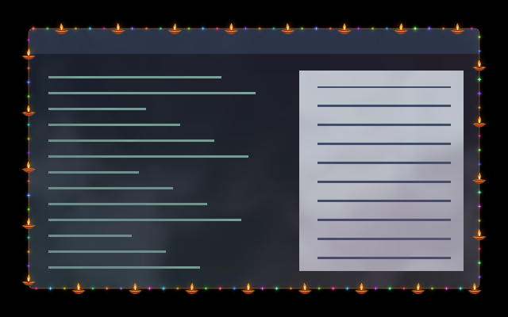

# Diwali shader pack

Five coordinated effects: small diya lamps and coloured border lights,
firework-backlit window clouds, a sparkling cursor trail, vivid cloud-puff
opening and closing, and a patterned rangoli iris for workspace changes.

| Surface | Effect | Motion preview |
| --- | --- | --- |
| Border | [Diya Lights](../../border/diya-lights/) — small upright lamps straddling the window edge, with coloured twinkles between them | [GIF](../../border/diya-lights/preview.gif) |
| Window | [Firelit Clouds](../../window/firelit-clouds/) — gentle roiling clouds illuminated from behind by coloured firework pulses | [GIF](../../window/firelit-clouds/preview.gif) |
| Cursor | [Festival Sparks](../../cursor/festival-sparks/) — small gold and rose sparks that lift and fade behind the pointer | [GIF](../../cursor/festival-sparks/preview.gif) |
| Open/close | [Cloud Puff](../../animation/cloud-puff/) — a brief outward cloud burst with bright gold, magenta and cyan backlighting | [Open](../../animation/cloud-puff/preview-open.gif) · [Close](../../animation/cloud-puff/preview-close.gif) |
| Workspace | [Rangoli Iris](../../animation/rangoli-iris/) — white floral linework on red, green, orange and blue rings, opening from the centre | [GIF](../../animation/rangoli-iris/preview.gif) |

## Install and enable

Install the collection at `~/.config/umbriel/shaders/community/`, or download
`effect.toml` and `shader.glsl` from the five linked directories above. Diya
Lights also requires both files from [Diya Glow](../../window/diya-glow-overlay/).
Keep their relative directory layout and the [MIT license](../../LICENSES/Barrulus-MIT.txt).

Merge [config.toml](config.toml) into `~/.config/umbriel/config.toml`: append
its five include paths and merge its selectors into the existing tables.
Do not duplicate TOML tables or include the activation example as a preset.
The border automatically includes its companion; do not include it separately.

The public preset names are:

- `diwali.diya-lights`, with the automatic `diwali.diya-glow-overlay` companion.
- `diwali.firelit-clouds` for window content.
- `diwali.festival-sparks` for the cursor trail.
- `diwali.cloud-puff` for both lifecycle events: **650 ms opening**, **550 ms closing**.
- `diwali.rangoli-iris` for workspaces: **1200 ms**, `style = "reveal"`.

Each effect also has an individual activation example. The pack does not
select a persistent screen effect. The rangoli is a full-scene workspace
transition. To disable an effect, restore its previous selector, clear the
selector, or disable the relevant animation event. Use `style = "slide"` if
returning to the compositor's native workspace transition.

Run `umbriel config validate` after merging settings. These files use relative
paths for the standard installation location; adjust them if installed elsewhere.

## Appearance and tuning

The lamps sit approximately half inside and half outside the client edge.
Their inward halves remain visible at output edges; the companion shares the
border's focus and fullscreen gates. The 14-pixel inner reach leaves the
central content clear. Firelit Clouds intentionally covers the whole window
with translucent clouds and independent coloured light pulses.

The cursor decorates the scene around the pointer, without replacing its image.
Cloud Puff is much brighter than the persistent clouds, but only runs during
the short lifecycle event. Rangoli Iris keeps both scenes stationary while
its aperture and ornament expand across the output.

Individual READMEs describe GLSL controls, timing and rendering cost. The diya
pair is generated from [shared artwork](tools/diya-material.glsl); after editing
that file, run `python3 packs/diwali/tools/generate_diya.py` from the repository
root to update both standalone shaders together. Installing the generated GLSL
requires no Python runtime or extra assets.

## Compatibility and validation

Tested with **Umbriel 0.1.0 (`8449975`)**. The commit matters: the version number
alone does not identify API support. Festival Sparks requires pointer history
(`umbriel_pointer_path` and `umbriel_pointer_count`). Rangoli Iris requires the
full-scene workspace reveal API with `umbriel_sample_incoming`. Border overlays
must follow their border's eligibility and clock.

All six programs have native compositor previews over synthetic content.
Publication validation additionally compiles the promoted names together in a
private session. The included [validation reports](validation/) record:

- Diya geometry, inward artwork at all four output edges, preserved central
  content and fullscreen gating; 144 border and 216 companion GLES frames.
- Firelit Clouds: a 96-frame native recording, 324 GLES frames and separate
  checks for independent cloud motion and light pulses.
- Festival Sparks: 72 native frames covering motion and rest, plus 432 GLES
  cases including history, jumps, expiry, output edges and source alpha.
- Cloud Puff: opening/closing recordings, 720 GLES cases and 164 additional
  frames confirming that visible source content never reverses direction.
- Rangoli Iris: 62 native frames across both navigation directions, exact scene
  endpoints and cancelled-swipe restoration; 480 GLES cases and 162 frames
  verifying that outgoing content does not reappear under the ornament.

Software GLES checks cover premultiplied alpha and transparent/translucent/opaque
sources. Native HDR, output rotation/fractional scaling, hardware performance
and prolonged desktop use remain unverified. No effect uses feedback buffers.

## Attribution

Original shader code by Barrulus with Codex assistance, under the
[Barrulus MIT license](../../LICENSES/Barrulus-MIT.txt). Diya perimeter geometry
adapts Barrulus's Fairy Lights and Ghostly Tear Border; cursor emission follows
the stable-history approach of Snowflake Trail. Rangoli Iris is a procedural
interpretation of a user-supplied floral reference; the reference bitmap is not
bundled. No external textures are required.
