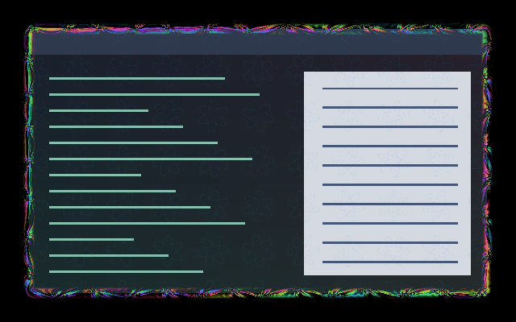

# Psychedelic

Four coordinated kaleidoscopic effects built from mirrored inversion fractals,
with magenta, cyan, violet and acid-green colour cycling.

| Effect | Appearance |
| --- | --- |
| [Fractal Iris](../../animation/fractal-iris/) | A rolling fractal front unfolds into new contours, with advance tears that widen and merge. |
| [Fractal Flow](../../border/fractal-flow/) | Rolling fractal folds open, split and merge around the focused border and its inward overlay. |
| [Fractal Veil](../../window/fractal-veil/) | Fine, moving 56-pixel kaleidoscope tiles, at at most 5.5% tint opacity. |
| [Fractal Bloom](../../animation/fractal-bloom/) | Windows open and close through a mirrored fractal mandala. |

## Enable

Install this collection at `~/.config/umbriel/shaders/community/`. Merge
[config.toml](config.toml) into your existing config, appending the four include
paths and merging existing tables. The border includes its companion overlay
automatically; do not include the companion again. Individual effects also
provide their own activation examples.

Defaults are an 1100 ms workspace iris, a 700 ms opening and a 450 ms closing,
all with linear timing. Fractal Iris uses the full-scene workspace reveal API;
Fractal Bloom handles window lifecycle events. The border and its overlay share
a clock and align at the client edge. Fractal Veil occupies the independent
window-effect slot, so it works alongside the border overlay.

Each shader exposes an `INTENSITY` constant. The persistent border is vivid;
the full-window tint is intentionally faint and never warps text. See individual
READMEs for scale, speed and width controls. There are no feedback buffers,
external textures or theme dependencies. Persistent effects animate continuously;
`[effects] max_fps` can cap effect-driven redraws. GPU cost depends on window
count and resolution.

To disable, restore your previous effect selectors or clear the border, window
and event `effect` strings. Clear the workspace effect and restore your previous
workspace style to return to native workspace transitions.

## Validation

The border was subsequently revised to use a continuously rolling fractal
contour, matching the unfolding iris. Its fading reach is eight pixels per side
with nine pixels of padding. See its README for motion previews, controls and
updated rendering cost. Its previous fixed diamond pattern has been removed.

Revised on **2026-10-25** for stronger kaleidoscope symmetry, a compact rolling
border (eight-pixel reach, down from the original 22) and moving 56-pixel window tiles.
The window tint ceiling is now 5.5%, down from 6.5%. All checks below were
rerun on the revision, including central symmetry of both animations.
The iris was subsequently reworked into an unfolding arrival-time front with
advance tears; its shape changes as new contours open rather than scaling a
fixed silhouette. See its README for updated controls and rendering cost.
The [window motion preview](../../window/fractal-veil/preview.gif) contains
61 native frames over six seconds.

Tested with **Umbriel 0.1.0 (`28fa214`)**. All five presets compiled and
rendered in private headless compositor sessions. The border, overlay and
window veil also compiled and rendered together in the preview above.
The combined pack configuration, all 136 installation examples and the combined
preset library passed configuration validation.

The [iris GIF](../../animation/fractal-iris/preview.gif) contains 26 native
frames; [opening](../../animation/fractal-bloom/preview.gif) and
[closing](../../animation/fractal-bloom/preview-close.gif) contain 18 and 13.
They use the configured durations with 50 ms capture steps and a short final
hold. The iris preview switches from a populated workspace to an empty one,
so the revealed scene is black. All still previews were visually inspected.

Supplemental software GLES checks use local Umbriel wrappers at `4531d927`:
624 frames per preset cover four logical aspect ratios, scales 1/1.5,
transparent/translucent/opaque sources, both animation directions and
out-of-range progress. Animation endpoints and monotonic visibility pass;
window alpha preservation and SDR premultiplication pass. These checks do not
substitute for native fractional-scale or HDR testing.

Native output rotation, HDR, interrupted transitions, desktop motion and GPU
performance remain unverified. The cycle entries retain their existing names.

## Attribution

Original procedural shaders by Barrulus, under the
[MIT license](../../LICENSES/Barrulus-MIT.txt).
