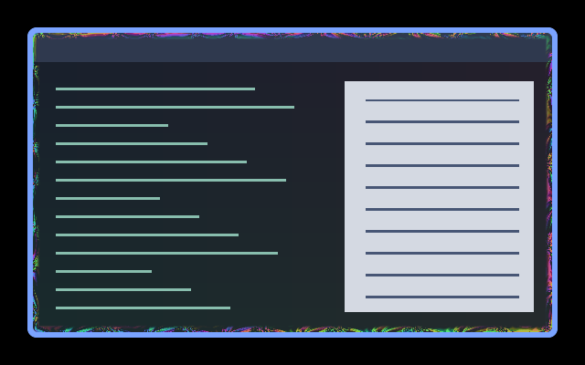

# Fractal Flow Overlay

The inward half of Fractal Flow, sharing its coordinates, colours and clock. Its rolling folds fade to the unchanged source within eight logical pixels, preserving source alpha.

## Use

Install the collection at `~/.config/umbriel/shaders/community/` and merge
[config.toml](config.toml) into your existing configuration tables, appending
its include paths. Do not include the activation example as a preset or repeat
existing TOML tables. Choose **Psychedelic → Apply family** in the plugin to apply the coordinated effects.

## Tuning

Edit INTENSITY, PATTERN_SCALE, REACH and ROLL_SPEED together with the border's matching constants. The border owns animation speed.

Controls are constants in [shader.glsl](shader.glsl), except border speed,
padding and event durations, which belong in TOML. Colours are procedural and
do not use the theme palette. No external textures are required.

## Compatibility and cost

Automatically included and selected by Fractal Flow. Use the border's config.toml; do not include this preset a second time. This overlay leaves the ordinary window-effect slot available for Fractal Veil. Six six-iteration fractal evaluations near the edge, one source sample, no history. Requires umbriel_corner_radius.

The preview is a real headless compositor capture over synthetic content.
 Still images do not demonstrate motion quality.

Tested in private Umbriel 0.1.0 (`28fa214`) sessions over synthetic content.
Native HDR, rotated or fractional-scale outputs, interrupted transitions and
hardware performance remain unverified.

Original procedural shader by Barrulus. [MIT licensed](../../LICENSES/Barrulus-MIT.txt).
