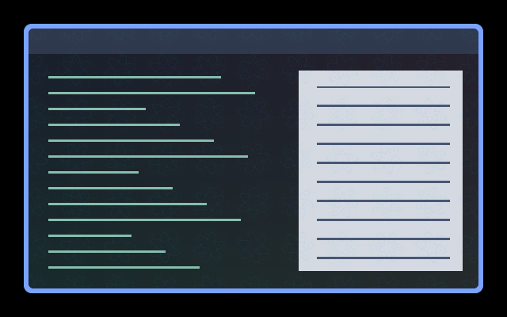

# Fractal Veil

Small kaleidoscopic rosettes fill the window with fine moving detail. Twelve mirrored wedges form nested petals and fractal lace; each tile rotates slowly and gently changes shape. Text stays stationary and source alpha is preserved. Maximum tint is 5.5%.

[Six seconds of fine movement](preview.gif), captured at 100 ms steps in the compositor.

## Use

Install the collection at `~/.config/umbriel/shaders/community/` and merge
[config.toml](config.toml) into your existing configuration tables, appending
its include paths. Do not include the activation example as a preset or repeat
existing TOML tables. Choose **Psychedelic → Apply family** in the plugin to apply the coordinated effects.

## Tuning

INTENSITY = 0.055 controls maximum tint opacity (0.02–0.15 recommended); PATTERN_SCALE = 56.0 sets logical pixels per kaleidoscope tile; SPEED = 0.18 controls motion phase per second. Each rosette rotates at 0.55 times that phase speed.

Controls are constants in [shader.glsl](shader.glsl), except border speed,
padding and event durations, which belong in TOML. Colours are procedural and
do not use the theme palette. No external textures are required.

## Compatibility and cost

One source sample and six bounded fractal iterations per pixel, per selected window. This continuously animated full-window pass costs more than edge-only decoration. No previous-frame feedback. Setting SPEED to zero freezes the artwork; disable the effect to remove its pass.

The preview is a real headless compositor capture over synthetic content.
 Still images do not demonstrate motion quality.

Tested in private Umbriel 0.1.0 (`28fa214`) sessions over synthetic content.
Native HDR, rotated or fractional-scale outputs, interrupted transitions and
hardware performance remain unverified.

Original procedural shader by Barrulus. [MIT licensed](../../LICENSES/Barrulus-MIT.txt).
