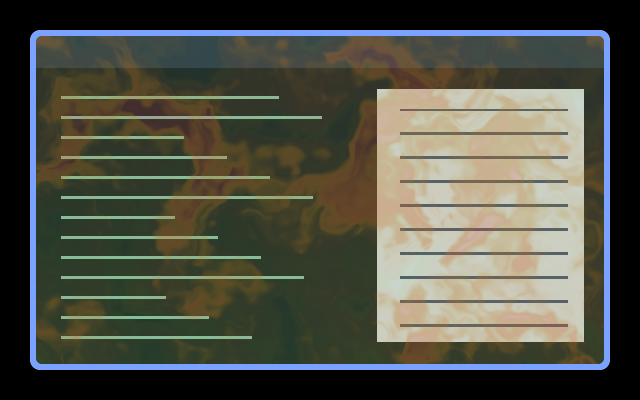

# Music Smoke

Translucent coloured smoke rises across the window. Audio controls its density,
bass changes the billows, and treble shifts the colour. Window content stays in
place, and silence or a missing feed restores the sampled scene unchanged.



Native Umbriel capture over synthetic window content with a synthetic spectrum.
The smoke uses its own colours rather than the theme palette.

## Use

Save [effect.toml](effect.toml) and [shader.glsl](shader.glsl) together in
`~/.config/umbriel/shaders/community/window/music-smoke/`. Keep the
[MIT license](../../LICENSES/Barrulus-MIT.txt) with the files. Then merge:

```toml
[include]
files = ["shaders/community/window/music-smoke/effect.toml"]

[effects]
window = "window.music-smoke"
```

Append to your existing include list and merge into existing tables.
[config.toml](config.toml) contains the same example. Global selection applies
to every window; use a window rule's `window_effect` for selected applications.

## Audio setup

Enable Noctalia's **Settings → Umbriel → Audio → Provide Audio to Umbriel**,
or use the [standalone Python analyser](../../tools/README.md#standalone-audio-analyser)
with older Noctalia or another shell. Run only one provider. Including this
preset does not start capture. [Spectrum](../../border/spectrum/) and
[Music Radiance](../../cursor/music-radiance/) can share the same feed.

Requires the 64-band `umbriel_audio_spectrum(position)` API, tested with
Umbriel `76477c2`. Remove old `[effects.audio.sources]` and per-preset `audio`
settings; the scalar and bumbriel 16-band APIs cannot run this version.

Activity is the square root of the mean of all 64 bands or one quarter of
their peak, whichever is greater, after gain and noise-floor adjustment.
This visual estimate replaces the old RMS/envelope inputs. Spectrum positions
`0.12` and `0.72` drive bass and treble; frequency centres depend on the provider.
A fresh feed can still contain silence, so availability alone does not enable
visible smoke. Isolated peaks elsewhere still affect overall density.

## Tuning

| Control | Default | Effect |
| --- | --- | --- |
| GLSL `AUDIO_GAIN` | `1.0` | Response strength; try `0.5`–`2.0`. High values saturate. |
| GLSL `NOISE_FLOOR` | `0.005` | Per-band dead zone; use `0` for maximum sensitivity, keep below `1`. |
| GLSL vertical time multiplier | `0.24` | Rise speed; positive values move smoke upward. |
| GLSL density ceiling | `0.52` | Maximum smoke mix; keep between `0` and `1`. |

The shader preserves sampled alpha and does not displace text. Window presets
have no TOML `speed` or `animated` controls. Global `[effects] max_fps` caps
effect-driven frames. For screenshots, enable `[effects] in_capture = true`
if needed. See [reloading edits](../../README.md#reloading-edits).

## Compatibility and cost

One pass per affected window, one scene sample, and no feedback buffers.
An available feed causes 64 spectrum samples for activity; audible input adds
two spectrum samples and three four-octave noise evaluations per fragment.
The linked shader reads time, so it can request frames even during silence.
Selecting it globally increases cost with the number and size of windows.
See [validation](../../VALIDATION.md) for tested behaviour and limitations;
hardware performance has not been benchmarked.

## Attribution

Author/contributor: Barrulus. [MIT](../../LICENSES/Barrulus-MIT.txt).
Ported from [bumbriel's Music Smoke](https://github.com/barrulus/bumbriel/tree/1dafcac5f008e7a9db32940839f1aff962909544/examples/effects/window/music-smoke).
Retuned for normalized 64-band intensities rather than linear 16-band
amplitudes and a separate RMS/envelope feed.
