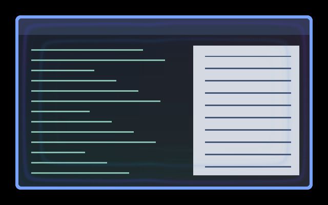

# Speaker Ripple

Audio-reactive pressure rings kick inward and recoil from all four window
edges, like a vibrating speaker surround. Bass moves the whole surround;
individual frequency bands buckle different parts of the rings like an
equaliser. Mids and treble move finer ripples and change their colours.
The waves fade before the centre to keep the main content readable. Silence
or a missing audio feed restores the original image.



Preview captured in a private headless Umbriel compositor over synthetic
window content. The audio spectrum changes while the compositor clock stays
frozen: all motion comes from those synthetic attacks and decays. This is not
real music playback. A [still preview](preview.png) is also available.

## Use

Save [effect.toml](effect.toml) and [shader.glsl](shader.glsl) together in
`~/.config/umbriel/shaders/community/window/speaker-ripple/`, retaining the
[MIT notice](../../LICENSES/Barrulus-MIT.txt). Merge this into your config:

```toml
[include]
files = ["shaders/community/window/speaker-ripple/effect.toml"]

[effects]
window = "window.speaker-ripple"
```

Append to an existing include list and merge into existing tables.
[config.toml](config.toml) contains the same activation example. This is a
standalone window effect; no border preset or companion is required. Global
selection affects all windows, including unfocused and fullscreen windows.
You can instead select it with a `window_effect` window rule; see
[selection examples](../../README.md#selecting-and-disabling-effects).

## Audio setup

Enable Noctalia's **Settings → Umbriel → Audio → Provide Audio to Umbriel**,
or run the [standalone analyser](../../tools/README.md#standalone-audio-analyser)
inside your Umbriel session:

```sh
python3 tools/audio-analyzer.py --verbose
```

Run that command from this repository. Use only one provider at a time.
Selecting the shader does not start audio capture. It uses the current
64-band `umbriel_audio_spectrum(position)` API, tested with Umbriel `76477c2`;
the older scalar and bumbriel audio APIs are incompatible.

The low, middle and high groups use bands 0–15, 16–39 and 40–63. Each group's
response is its mean or one quarter of its peak, whichever is larger, after
noise rejection and gain. This keeps isolated tones visible. Brightness uses
a square-root lift; wave positions use the uncompressed levels.
These are visual intensities; precise frequency ranges depend on the provider.
The local spectrum runs from bass on the left through mids along the top and
bottom to treble on the right. Rising levels push crests inward; falling levels
pull them back. Positions, inward reach, distortion and colours follow the
current spectrum directly. A held spectrum produces a still image even as time
passes. Sharp attacks jump; sustained notes hold. Provider smoothing determines
how sharp those changes are. This is a spectrum visualiser, not a waveform trace
or a beat detector with stored history.

## Tuning

Edit the constants near the top of [shader.glsl](shader.glsl):

| Control | Default | Effect |
| --- | --- | --- |
| `AUDIO_GAIN` | `1.0` | Sensitivity; try `0.5`–`2.0`. |
| `NOISE_FLOOR` | `0.005` | Per-band silence threshold; keep between `0` and `0.1`. |
| `REACH` | `170.0` | Maximum inward reach in logical pixels; also capped at 44% of the shorter window dimension. Keep positive. |
| `WAVELENGTH` | `32.0` | Ring spacing in logical pixels; try `20`–`60`. |
| `JUMP_DISTANCE` | `90.0` | Audio-driven crest excursion in logical pixels, capped at 30% of the shorter dimension. Try `40`–`120`; larger makes peaks jump farther. |
| `DISPLACEMENT` | `3.0` | Content vibration in logical pixels; `0` keeps just the coloured rings. Try `0`–`6`. |
| `COLOUR_STRENGTH` | `0.62` | Colour intensity; try `0.2`–`0.9`, or `0` for distortion only. |
| `CORNER_SOFTNESS` | `18.0` | Softens the meeting of waves at corners; try `8`–`30`, keep positive. |

The preset defaults to `palette = false` for vivid spectrum-responsive colours.
Set `palette = true` in [effect.toml](effect.toml) to use theme colours instead;
audio still shifts the palette position. Window presets do not accept TOML
`speed`, `opacity` or `animated` controls. Global `[effects] max_fps` can limit
effect-driven redraws; `in_capture = true` includes this effect in captures.

## Compatibility and cost

One pass per affected window, up to two content samples and a bounded scan of
64 spectrum bands plus one local spectrum lookup per fragment. No previous-frame
buffers are used. Source alpha is preserved. There is no animation clock;
audio updates drive redraws. Large windows and global selection increase cost;
hardware performance has not been benchmarked.

Synthetic-audio checks cover silence, disconnection and frequency response.
Real playback appearance, HDR, rotated or fractional-scale outputs and hardware
performance have not been fully verified.

## Attribution

Author/contributor: Barrulus. [MIT](../../LICENSES/Barrulus-MIT.txt).
Contributed on 2026-10-26.
